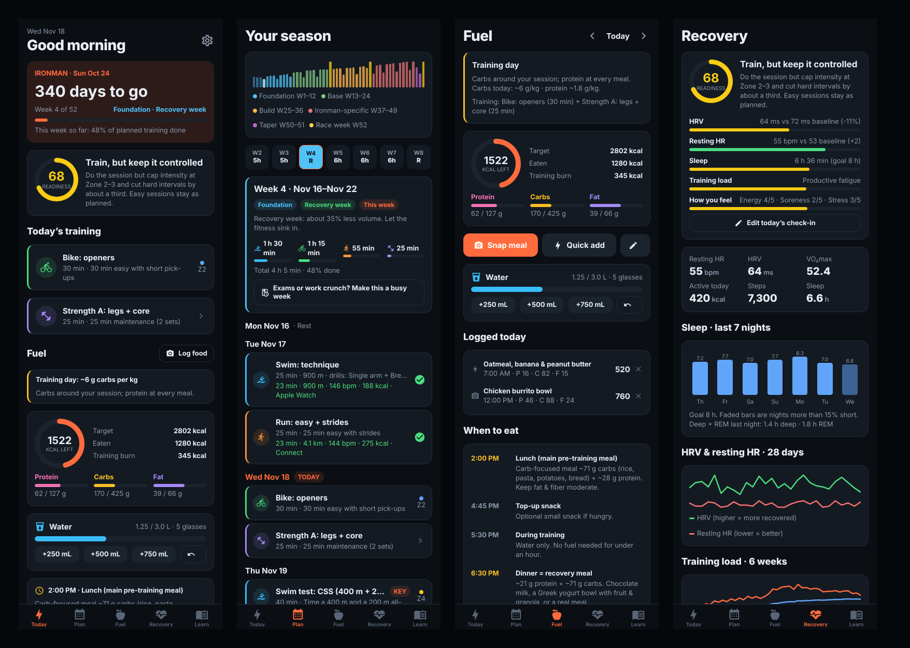

# IronPath: your first-Ironman coach (iPhone)

A personal Ironman training app for a beginner triathlete with one year to race day:
a weak swimmer, decent cyclist and okay runner who plays soccer, lifts, and fits
training around school and a job.



## What it does

| | |
|---|---|
| **52-week periodized plan** | Foundation → Base → Build → Ironman-specific → Taper → Race week. Recovery every 4th week, peak around 12–13 h/week, long ride up to 5¼ h, long run capped at 2½ h. |
| **Fits your real schedule** | You set the max minutes you have each weekday. The scheduler never goes over it, keeps key sessions first, and warns when a phase needs more time. Tap **Busy week** for exams or work crunches (−40% volume). |
| **Swim-first for a weak swimmer** | 3 swims a week from day one, technique drills that rotate weekly, CSS testing every ~8 weeks, open-water skills in Build/Peak. |
| **Soccer & lifting aware** | Soccer days count as hard days, and extra run intervals drop when you play 2+ times a week. Strength 2× → 1× through the season, never the day before a long ride. |
| **Garmin + Apple Watch sync** | Reads workouts (sport, duration, distance, calories, avg/max HR), resting HR, HRV, sleep stages, steps, active calories and VO₂max from **Apple Health**, and matches them to your plan automatically. |
| **Readiness score** | Daily 0–100 from HRV & resting HR vs your own baseline, sleep, training load (fitness/fatigue/form) and a 20-second check-in (energy, soreness, life stress, motivation). Green / yellow / red with what to do. |
| **Food photos → calories & macros** | Snap your plate and Claude's vision estimates each item's portion, calories, protein, carbs, fat and fiber, then gives you an athlete-specific tip. Quick-add staples and manual entry work offline. |
| **Daily fuel targets** | Calories from your BMR + lifestyle + the day's training (measured kcal from your watch when available). Carbs scale 3.5 → 8.5 g/kg with the day's load, protein ~1.8 g/kg. |
| **Meal timing** | A timeline for today based on when you train: pre-session meal, top-up snack, fueling during (30–90 g carbs/h), recovery meal, bedtime protein, plus race-day fueling. |
| **Hydration** | Water target = 35 mL/kg + 80% of training sweat losses. One-tap logging and a built-in sweat-rate test. |
| **Learn** | Ironman 101 (distances, typical cutoffs), choosing & registering a race, swim coaching, fueling, hydration, soccer + tri, lifting, training as a student who works, gear checklist, recovery warning signs, safety. |

## How the Garmin + Apple Watch connection works

Apple Health is the hub:

- **Apple Watch** writes workouts, heart rate, HRV, sleep and calories to Apple Health on its own.
- **Garmin** writes to Apple Health through the Garmin Connect app (Settings → Connected Apps → Apple Health; turn on Activities, Heart Rate, Sleep, Steps, Calories).
- **IronPath** reads Apple Health, so it gets both devices through one integration and re-syncs every time you open the app.

Why not Garmin's own API? Garmin's Health/Activity APIs are only for approved business partners, and they need a server. Apple Health is the supported, on-device route for a personal app. IronPath can also *write* the food and water you log back to Apple Health (toggle in Settings).

## Use it on your iPhone today (website, free)

The website version runs in Safari and installs on your home screen like an app. No Mac and no Apple developer account needed.

**One-time setup (owner of the GitHub repo, 30 seconds):**
GitHub → this repo → **Settings → Pages** → *Build and deployment*: Source **Deploy from a branch**, Branch **`claude/ironman-training-app-xauwlq`**, folder **`/docs`** → **Save**. After a minute or two the site is live at:

**https://jasonkaiser1605-max.github.io/remotion-hello-world/**

**Put it on your home screen:** open that link in **Safari** on your iPhone → tap **Share** → **Add to Home Screen** → **Add**. It opens full-screen with its own icon, and your data stays on your phone.

What's different on the website:
- **No automatic Garmin / Apple Watch sync.** Websites can't read Apple Health. After a workout, tap it in the app and choose **Log what your watch recorded** (minutes, distance, avg HR, calories), and add your hours slept in the morning check-in. Automatic sync needs the installed app (below).
- Food photos work (tap **Take or choose photo**) with your Anthropic API key, stored only in that browser.
- Data lives in the home-screen app's storage. If you delete the icon, the data goes with it.

To update the website after changing code: `cd ironpath && npm run build:web`, then commit and push the `docs/` folder.

## Install the native app (automatic Garmin + Apple Watch sync)

Apple Health access needs a real native app build, so **Expo Go won't work**. Pick one option:

### Option A: you have a Mac (free)

1. Install Xcode from the Mac App Store and open it once. Sign in with your Apple ID under Xcode → Settings → Accounts.
2. Plug in your iPhone and turn on Developer Mode (Settings → Privacy & Security → Developer Mode).
3. Run:

   ```bash
   cd ironpath
   npm install
   npx expo run:ios --device
   ```

4. Pick your phone when asked. On the phone, trust the developer profile under Settings → General → VPN & Device Management.

With a free Apple ID, the app has to be re-installed from your Mac every 7 days. If Xcode refuses the HealthKit capability on a free account, use the paid program from Option B.

### Option B: no Mac (Apple Developer Program, $99/yr)

```bash
cd ironpath
npm install
npx eas-cli@latest login            # free Expo account
npx eas-cli@latest device:create    # register your iPhone (opens a link on the phone)
npx eas-cli@latest build --profile development --platform ios
```

Open the link EAS gives you on your iPhone to install the build. Then, whenever you change code:

```bash
npx expo start --dev-client
```

For a permanent install without a dev server, run `npx eas-cli@latest build --profile preview --platform ios`, or submit to TestFlight with `eas submit`.

### First launch

1. Onboarding comes pre-filled with your stats (5′8″, 156 lb, swim weak / bike decent / run okay, soccer, 2× lifting). Set your age, daily minutes and race date.
2. Tap **Connect Apple Health** and allow everything.
3. In Garmin Connect, enable Apple Health sharing (see above).
4. Optional: add an Anthropic API key (Settings → AI food photos) for photo logging. Create one at <https://console.anthropic.com/settings/keys>. Each photo costs roughly 1–2¢. The key is kept in the iOS Keychain and is only ever sent to `api.anthropic.com`.

## Your default plan at a glance

Plan starts **Mon Nov 23, 2026**, race **Sun Nov 21, 2027** (change both in Settings; the plan re-shapes itself).

| Weeks | Phase | Typical week | Focus |
|---|---|---|---|
| 1–12 | Foundation | 5–6.5 h | Swim technique 3×, easy aerobic bike/run, lifting 2×, baseline tests |
| 13–24 | Base | 7.5–9 h | Long ride 2–2½ h + first bricks, swim endurance, tempo/hills. **Wk 24: sprint/Olympic tune-up** |
| 25–36 | Build | 9.5–10.5 h | Threshold intervals, open water, 3–3½ h rides. **Wk 36: 70.3 dress rehearsal** |
| 37–49 | Ironman-specific | 11–13 h | 4–5¼ h rides with IM-pace blocks, 2–2½ h long runs, race nutrition practice |
| 50–51 | Taper | 10 h → 7 h | Volume down, a little intensity, lots of sleep |
| 52 | Race week | – | Short openers, gear check, **race day** |

Every 4th week is a recovery week (about 35% less). Default availability: Mon rest · Tue 1½ h · Wed 1 h · Thu 1½ h · Fri 1 h · Sat 5½ h · Sun 3 h. Early weeks use much less than that; it's a ceiling.

## Development

```bash
npm install
npm test            # 46 unit tests: plan generator, zones, nutrition, readiness, load, matching
npm run typecheck   # tsc --noEmit
npm run lint        # expo lint
npm run web         # browser preview (Apple Health unavailable; add ?demo to the URL for demo data)
npm run build:web   # build the GitHub Pages website into ../docs
```

```
src/
  app/                 Expo Router screens
    (tabs)/            Today · Plan · Fuel · Recovery · Learn
    workout/[id].tsx   workout detail (steps, zones, recorded data, move/skip)
    food/add.tsx       photo / quick / manual food logging
    settings.tsx, onboarding.tsx
  lib/                 pure TypeScript (no React Native), unit-tested
    plan.ts            periodization + time-capped scheduler
    workouts.ts        workout library (swim drills, intervals, bricks, strength)
    nutrition.ts       BMR, daily targets, meal timing, hydration, sweat rate
    readiness.ts       HRV/RHR/sleep/load/check-in readiness score
    load.ts            training load (fitness / fatigue / form)
    zones.ts           HR zones (Karvonen / LTHR), CSS swim pace, power zones
    match.ts           match Apple Health workouts to planned sessions
    knowledge.ts       Learn tab content
  services/
    health.ts          Apple HealthKit (via @kingstinct/react-native-healthkit)
    foodVision.ts      Claude vision food analysis (structured output)
    secrets.ts         API key in the iOS Keychain
  store/               zustand + AsyncStorage (all data stays on the phone)
```

Built with Expo SDK 58, React Native 0.88, Expo Router, `@kingstinct/react-native-healthkit`, `expo-image-picker`, and the Anthropic TypeScript SDK.

## Disclaimer

General training guidance, not medical advice. Get a sports physical before a year of endurance training. Race cutoffs and rules vary by event, so always check your race's athlete guide.
